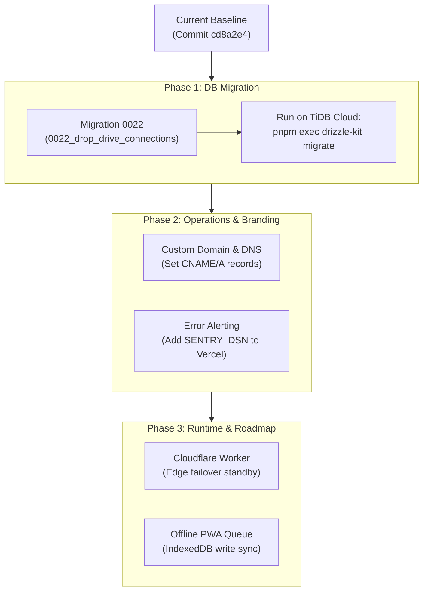

# Production Status & Terminal-Safe Roadmap

**App:** Money Tracker (আমার হিসাব)  
**Host:** Vercel (`money-tracker-blond-pi.vercel.app`, `sin1`)  
**Database:** TiDB Cloud Serverless (MySQL 8 compatible)  
**Baseline Commit:** `cd8a2e4`  
**Security Status:** 0 known vulnerabilities (`pnpm audit` = 0)  

---

## 1. Terminal-Safe Production Flowchart (≤ 55 Columns)

> [!NOTE]
> Designed according to the Terminal Width Standard (≤ 80–93 cols). Formatted vertically with `<br/>` wraps so it renders inline as a visual diagram in any CLI or terminal viewer without falling back to raw code blocks.



---

## 2. Text / ASCII Alternative (Zero Dependencies)

```text
[Baseline: cd8a2e4]
       │
       ▼
[Phase 1: Database] ──► Apply 0022_drop_drive_connections.sql via drizzle-kit migrate
       │
       ▼
[Phase 2: Ops]      ──┬──► Custom Domain (CNAME / DNS in docs/custom-domain-dns-topology-bn.md)
                      └──► Error Monitoring (Optional: SENTRY_DSN in Vercel Dashboard)
       │
       ▼
[Phase 3: Edge]     ──┬──► Cloudflare Worker (Ready as edge standby runtime)
                      └──► PWA Offline Sync (Transaction write queue)
```

---

## 3. Production Readiness Checklist

| Category | Item | Status | Action Required |
|---|---|---|---|
| **App Code** | All accounting, auth, reports, SMS parser, tax calc | **100% Complete** | None |
| **CI / CD** | 5 required status checks (`verify`, `test`, `e2e`, `worker`, `browser-e2e`) | **Passing** | None |
| **Security** | Pinned `jose`, timing-safe auth, RBAC, dependency audit | **0 CVEs** | None |
| **Backups** | Daily encrypted backups (AES-256-GCM) + Weekly restore drills | **Operational** | None |
| **Database** | Migration 0022 (`drive_connections` table cleanup) | **Pending** | **Owner execution via drizzle-kit migrate** |
| **Custom Domain** | Bind custom apex/subdomain | **Optional** | Point CNAME to `cname.vercel-dns.com` |
| **Sentry** | Production error monitoring | **Optional** | Set `SENTRY_DSN` in Vercel Dashboard |

---

## 4. Owner Migration Runbook (0022_drop_drive_connections.sql)

```bash
# 1. Export production TiDB connection string (from Vercel or TiDB Cloud Dashboard)
export DATABASE_URL="mysql://<user>:<password>@<tidb-host>:4000/money_tracker?ssl=true"

# 2. Apply pending migration safely (NEVER run db:push)
pnpm exec drizzle-kit migrate

# 3. Verify that drive_connections was dropped and 34 finance tables remain intact
mysql -h <tidb-host> -P 4000 -u <user> -p -D money_tracker -e "
  SHOW TABLES LIKE 'drive_connections';
  SELECT COUNT(*) AS finance_tables FROM information_schema.TABLES 
  WHERE TABLE_SCHEMA=DATABASE() AND TABLE_NAME LIKE 'finance_%';
"
```

---

## 5. Future Feature Backlog (Post-Launch Roadmap)

| Priority | Feature | Description | Architecture / Implementation Path |
|---|---|---|---|
| **F-01** | **PWA Offline Write Queue** | Assets and fonts are cached, but transactions currently require internet connectivity. An IndexedDB queue synchronizes transactions created while offline. | `idb` / local storage write queue; background replay via service worker sync on `online` event to `/api/trpc/expenses.create` & `/api/trpc/incomes.create`. |
| **F-02** | **Household Member Email Invitations** | Granular onboarding workflows for inviting secondary family members with read-only or input-only roles. | Tokenized invitation links (`crypto.randomBytes(32)`), email delivery, and RBAC integration via `server/_core/rbac.ts`. |
| **F-03** | **POS / Thermal Receipt Printing** | Formats optimized for small Bluetooth POS printers (58mm / 80mm ESC/POS or `@media print`) for micro-merchant bookkeeping in Bangladesh. | CSS thermal print view with Bengali font rasterization and optional Web Bluetooth ESC/POS raw byte printer bridge. |

